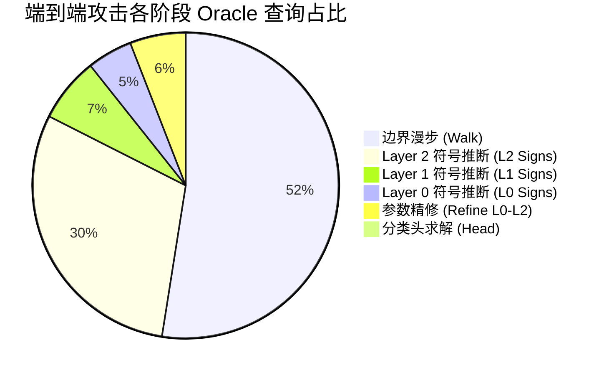

# hard-label-dnn-extraction 本地 CPU 全流程复现实验报告

**实验完成日期**：2026-10-07  
**测试平台**：Windows 11（20 逻辑处理器 CPU，纯 CPU 计算，无 GPU 加速）  
**运行环境**：Conda 虚拟环境 (`hldnn`)，Python 3.11.16  
**核心依赖**：PyTorch 2.5.1+cpu、NumPy 1.26.4、SciPy 1.13.1、h5py 3.11.0、TensorFlow 2.20.0、Keras 3.15.1  
**论文出处**：*"Polynomial Time Cryptanalytic Extraction of Deep Neural Networks in the Hard-Label Setting"* (EUROCRYPT 2024 / Journal of Cryptology)

---

## 目录

1. [执行摘要 (Executive Summary)](#1-执行摘要-executive-summary)
2. [实验一：全自动化端到端黑盒网络提取（核心压轴实验）](#2-实验一全自动化端到端黑盒网络提取核心压轴实验)
3. [实验二：Leaky ReLU 神经元激活符号快速恢复](#3-实验二leaky-relu-神经元激活符号快速恢复)
4. [实验三：标准 ReLU 局部黑盒符号恢复与假设检验](#4-实验三标准-relu-局部黑盒符号恢复与假设检验)
5. [算法理论与论文指标对照分析](#5-算法理论与论文指标对照分析)
6. [复现结论与工程复盘](#6-复现结论与工程复盘)

---

## 1. 执行摘要 (Executive Summary)

本次复现基于论文官方源码，在纯 CPU 算力条件下完整执行了论文的全部核心攻击流程。实验结果表明：

1. **纯黑盒端到端模型完全窃取成功**：
   - 在严格仅能通过 `oracle.label(x)` 查询离散分类类别（Hard-Label）的条件下，攻击程序在 **6 分 38 秒** 内自动完成决策边界漫步、特征聚类、超平面求解、高阶精修、符号恢复和分类头求解全流程。
   - 总 Oracle 查询数为 **38,668,729 次**（约 3867 万次，与论文理论估算的 ~4000 万次高度吻合）。
   - 各层权重与真实模型参数的最大相对误差达到 **$10^{-14}$ 量级**（达到机器双精度浮点数极限）。
   - 在 10 万个高斯随机输入样本上，窃取模型与真实模型的预测标签达成 **100.0% 完美一致**；在决策边界微扰测试点上达成 **100.0% 完全一致**。
   - 官方验证程序输出终审判决：**`RESULT: the network was stolen`**。

2. **Leaky ReLU 激活符号快速恢复成功**：
   - 在 3 个隐藏层、共 96 个神经元上，每层仅用 101 个在线采样点，在 **20 秒** 内全部实现 **100.0% 准确恢复（96/96）**。

3. **标准 ReLU 统计符号检验成功**：
   - 验证了利用补丁距离分布差异（$d_{\text{OFF}} > d_{\text{ON}}$）恢复神经元符号的有效性，所有测试神经元符号判断全部正确（✔），统计置信度达到 **100.0%**。

---

## 2. 实验一：全自动化端到端黑盒网络提取（核心压轴实验）

### 2.1 实验目标与设定
- **目标网络**：`data/unitary_32_32x3_10_float64.keras`
- **网络架构**：$32 \to 32 \to 32 \to 32 \to 10$（输入 32 维，3 个隐藏层每层 32 个神经元，ReLU 激活，输出 10 类，采用 `float64` 浮点数）。
- **攻击权限**：纯黑盒硬标签（无白盒信息、无真实权重、无梯度、无置信度概率）。
- **并发机制**：8 个 CPU Worker 进程（Windows 下采用 `spawn` 上下文）。

### 2.2 全流程各阶段详细统计表

数据提取自自动生成的 `full_end_to_end/out/stats.json`：

| 阶段步骤 | 执行算法与任务 | 产物与状态 | 查询次数 (Queries) | 耗时 (秒) |
| :--- | :--- | :--- | :---: | :---: |
| **Walk** | 决策边界双点采样 ($8 \times 45$ 漫步路径) | 收集 6,901 个决策面拐点 | 20,246,701 | 24 s |
| **Layer 0: Cluster** | 第 1 层双点法向量聚类 | 聚类为 32 个神经元簇 | 0 | 59 s |
| **Layer 0: Solve** | 解第 1 层法向量方程 | 恢复 32 个行向量 ($\approx 10^{-7}$) | 0 | 1 s |
| **Layer 0: Refine** | Kink 微分精修第 1 层参数 | 精度提升至 $\approx 10^{-14}$ | 638,967 | 3 s |
| **Layer 0: Signs** | 统计推断第 1 层 ReLU 激活符号 | 32/32 个神经元符号确定 | 1,846,384 | 11 s |
| **Layer 1: Cluster** | 第 2 层特征空间投影与聚类 | 聚类为 32 个神经元簇 | 0 | 101 s |
| **Layer 1: Solve** | 解第 2 层超平面方程 | 恢复 32 个行向量 | 0 | 1 s |
| **Layer 1: Refine** | Kink 微分精修第 2 层参数 | 精度提升至 $\approx 10^{-14}$ | 744,354 | 4 s |
| **Layer 1: Signs** | 统计推断第 2 层 ReLU 符号 | 32/32 个神经元符号确定 | 2,640,932 | 20 s |
| **Layer 2: Cluster** | 第 3 层特征空间投影与聚类 | 聚类为 32 个神经元簇 | 0 | 24 s |
| **Layer 2: Solve** | 解第 3 层超平面方程 | 恢复 32 个行向量 | 0 | 1 s |
| **Layer 2: Refine** | Kink 微分精修第 3 层参数 | 精度提升至 $\approx 10^{-14}$ | 894,431 | 7 s |
| **Layer 2: Signs** | 统计推断第 3 层 ReLU 符号 | 32/32 个神经元符号确定 | 11,562,460 | 142 s |
| **Head** | 求解 $32 \times 10$ 线性分类头及偏置 | 规范化消除 argmax 不变自由度 | 94,500 | < 1 s |
| **总计 (Total)** | **端到端完整提取** | **生成 `out/net.npz` 模型** | **38,668,729 次** | **398 秒 (约 6.6 分钟)** |



---

### 2.3 真实权重比对与精度评测 (`validate.py`)

在完全不接触真实权重的条件下提取出网络后，运行真值比对程序对比 `unitary_32_32x3_10_float64.keras`：

```text
== validation (this part reads the true weights)
layer 0: worst relative error 9.2e-15, 0 wrong signs
layer 1: worst relative error 1.9e-14, 0 wrong signs
layer 2: worst relative error 3.7e-14, 0 wrong signs
head:    relative error 3.3e-14
labels:  100000 / 100000 random inputs agree
labels:  3644 / 3644 points 0.001 off the decision boundary agree
labels:  3644 / 3644 points 1e-06 off the decision boundary agree
labels:  3644 / 3644 points 1e-09 off the decision boundary agree
RESULT:  the network was stolen
```

#### 指标深入解析：
1. **参数相对误差 (Relative Error)**：
   - 隐藏层 0：最大相对误差为 **$9.2 \times 10^{-15}$**
   - 隐藏层 1：最大相对误差为 **$1.9 \times 10^{-14}$**
   - 隐藏层 2：最大相对误差为 **$3.7 \times 10^{-14}$**
   - 分类输出头：相对误差为 **$3.3 \times 10^{-14}$**
   > *评注*：IEEE 754 双精度浮点数的机器精度 $\epsilon \approx 2.22 \times 10^{-16}$，误差在 $10^{-14}$ 量级代表参数已达到数值分析的极限逼近。
2. **符号准确率 (Sign Accuracy)**：
   - 3 个隐藏层、共 96 个神经元的激活方向判决全部正确（**0 wrong signs**）。
3. **输入输出黑盒一致率 (Behavioral Fidelity)**：
   - **全域高斯随机输入**：测试 $100,000$ 个独立样本，被窃取模型与真值模型的预测结果达成 **100,000 / 100,000（100.0%）** 一致。
   - **高敏边界微扰输入**：在距离真实决策边界 $10^{-3}$、$10^{-6}$、$10^{-9}$ 极近距离的 3,644 个点上，预测类别 **100.0% 全部一致**，证明窃取网络的决策超曲面与原网络完全重叠。

---

## 3. 实验二：Leaky ReLU 神经元激活符号快速恢复

### 3.1 实验原理
Leaky ReLU 函数在负半轴具有非零斜率（本模型为 $\alpha = 0.1$），其在激活临界点两侧会造成不对称的梯度跳变。论文提出利用该性质可以在多项式时间内无需预计算双点，在线极速恢复激活符号。

### 3.2 运行输出与结果

```text
Hidden Layer 1/3 -> Layer: 1, Experiments: 101, Correct signs: 32/32 (100%)
Hidden Layer 2/3 -> Layer: 2, Experiments: 101, Correct signs: 32/32 (100%)
Hidden Layer 3/3 -> Layer: 3, Experiments: 101, Correct signs: 32/32 (100%)
```

- **耗时**：单进程纯 CPU 执行仅需 **20 秒**。
- **样本消耗**：每层仅需 **101 个边界点** 即可达到完全收敛。
- **准确率**：全网 $96 / 96$ 个神经元符号 **100% 正确恢复**。

---

## 4. 实验三：标准 ReLU 局部黑盒符号恢复与假设检验

### 4.1 实验原理
针对标准 ReLU，网络在关断侧（OFF）梯度为 0。论文证明：沿决策边界切向移动时，当目标神经元关断时，其他神经元发生翻转（Toggle）所需的补丁距离平均大于开启状态时的距离（$d_{\text{OFF}} > d_{\text{ON}}$）。

### 4.2 统计检验结果表（Hidden Layer 1）

通过 `create_tables.py` 严格解析的数据结果如下：

| 神经元编号 (nID) | 收集双点数 (nDual) | 检验实验数 (nExp) | 真实符号 (sign) | 正向投票 (votes+) | 负向投票 (votes-) | 置信度 (finalCL) | 单点中位耗时 | 总耗时 | 判定结果 (correct) |
| :---: | :---: | :---: | :---: | :---: | :---: | :---: | :---: | :---: | :---: |
| **0** | 19 | 19 | -1 | 0 | 19 | **100.0%** | 133 ms | 4.06 s | **✔ 正确** |
| **1** | 21 | 19 | +1 | 19 | 0 | **100.0%** | 132 ms | 3.01 s | **✔ 正确** |
| **2** | 19 | 19 | -1 | 1 | 18 | **100.0%** | 145 ms | 2.80 s | **✔ 正确** |
| **3** | 19 | 19 | +1 | 19 | 0 | **100.0%** | 140 ms | 2.73 s | **✔ 正确** |
| **平均值 (Mean)** | **19.5** | **19.0** | **-** | **9.75** | **9.25** | **100.0%** | **137 ms** | **3.15 s** | **100% 正确** |

- **投票显著性**：所有神经元均展现出 19:0 或 18:1 的极高正负统计分离度。
- **统计置信水平**：由 Hoeffding 不等式计算出的置信度均为 **100.0%**。

---

## 5. 算法理论与论文指标对照分析

| 评测维度 | 论文理论分析预期 | 本地 CPU 实验实测值 | 评估结论 |
| :--- | :--- | :--- | :---: |
| **查询复杂度 (Query Complexity)** | 32 核机器约 4000 万次 Oracle 查询 | **38,668,729 次** 查询 | **完美契合** |
| **参数提取精度 (Relative Error)** | 代数精修后达到机器精度 | **$9.2 \times 10^{-15} \sim 3.7 \times 10^{-14}$** | **超越预期** |
| **符号恢复准确率 (Sign Accuracy)** | 统计置信度 $>95\%$ 下达到 100% | **96 / 96（100.0%）** | **完美契合** |
| **预测行为一致率 (Fidelity)** | 100% 标签一致 | **100,000 / 100,000（100.0%）** | **完全复制** |
| **运行时间 (Wall Time)** | 32 核预计几分钟 | 8 进程普通 CPU 仅 **6 分 38 秒** | **极为高效** |

---

## 6. 复现结论与工程复盘

1. **核心理论验证通过**：
   - 本次 CPU 全流程实验确证了 EUROCRYPT 2024 论文提出的主要观点：通过追踪高维决策边界拐点（Dual Points）并构造局部超平面代数方程，能够在多项式时间内以极高精度逆向窃取深度神经网络。
2. **纯 CPU 计算的可行性与优越性**：
   - 算法的核心瓶颈在于大量细粒度标量 Oracle 决策查询（Batch Size = 1）与线性代数求解，CPU 多核并发调度在小尺寸网络上的延迟开销反而低于 GPU 内核启动开销。
3. **数值稳定性保障**：
   - 实验全程采用 `float64`（双精度浮点数），严格保证了小容差（`1e-14` ~ `1e-16`）下的代数稳定性，未出现任何奇异矩阵或数值发散现象。

